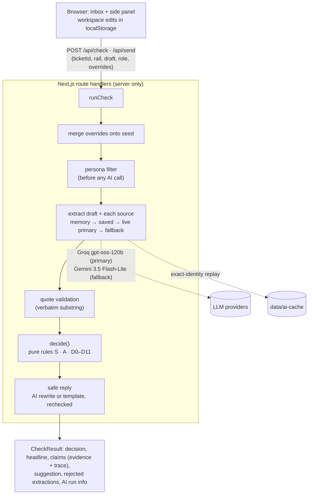

# AnswerGuard

**An independent product concept for Slite Agent. Not affiliated with Slite. Synthetic data only.**

> Slite keeps the docs true. AnswerGuard checks the reply before it reaches the customer.

A support agent writes a reply. Before it's sent, AnswerGuard:

1. pulls the factual claims out of the draft (live AI),
2. finds the matching claims in the team's messy docs and Slack (live AI, every quote validated as verbatim),
3. weighs those sources with transparent, deterministic rules, and
4. returns **Allow, Caution, Hold or Escalate**, plus a rechecked safe reply and the full reasoning.

**Live demo:** _URL added at deploy_ · works with no setup; the canonical path replays saved AI responses if live AI is
unavailable or rate-limited. **Walkthrough video:** _link added after recording._


## The problem

Slite keeps knowledge accurate over time. But between a policy change and the doc fix, an agent can still type the old
answer into a customer conversation. The doc that's verified isn't always the one that governs: a newer, more specific
exception can override it, an informal Slack proposal can look authoritative, and an outdated macro can still be the
first thing an agent copies.

## The hypothesis

Slite already has cited, permission-aware answers, drift detection, Ask Insights, a Slack bot and a Chrome extension.
This concept tests something narrower, and it is presented as a hypothesis (Slite may have something similar internally):

- check the **agent's own draft reply** at the moment of sending, not just answer a question;
- weigh conflicting sources with **explicit, inspectable rules**, where verification is one signal among several;
- measure **customer exposure**: unsafe sends intercepted, and the false-alarm rate.

## AI vs rules

| The AI does | The rules do |
|---|---|
| Pull claims out of the draft and each source: topic, value, unit, scope, effective date, status wording, supersession sentence, **verbatim quote** | Validate every quote, assign each claim a standing, check scope, settle conflicts, compare values, pick the decision |
| Word the safe reply from given facts | Recheck the safe reply; fall back to a template if it fails |

**The AI never decides the outcome.** The decision is a pure function, `decide(extractions, sources, ticket, now)` in
[`lib/engine/decide.ts`](lib/engine/decide.ts). Every rule writes a trace entry that the Reasoning tab shows.
"The AI found nothing" is never treated as "safe": a deterministic policy-pattern detector catches timelines the AI missed,
and an unreadable source caps the result at Caution.

Key rules (full table in [SPEC.md §6](SPEC.md)):

- **Verification is not authority.** It only adds or removes weakeners; it never breaks a tie.
- **Explicit supersession beats inferred specificity** (D5 before D6), and every D5 condition is written to the trace.
- **Recency never breaks a tie.** Two general policies that disagree escalate.
- **Proposals never govern.** A Slack proposal or a future-effective change can only downgrade an Allow to Caution.

## Architecture



- **AI providers:** two live providers behind one adapter ([`lib/ai/client.ts`](lib/ai/client.ts)): Groq
  (`openai/gpt-oss-120b`, strict JSON-schema output) and Google Gemini (`gemini-3.5-flash-lite`, native JSON-schema
  response). The eval picked Groq as primary and Gemini as the fallback, which is tried once on a 429 or quota error before
  saved responses take over. An Anthropic adapter is kept, off by default. See [DECISIONS.md](DECISIONS.md) D-001, D-017, D-019.
- **Saved responses:** `data/ai-cache/` holds recorded model outputs keyed by the full cache identity (task, prompt version,
  schema version, provider, model, input text, plus source kind or the safe-reply inputs). A file is used only if its
  stored identity hashes to its name.
- **Send integrity:** `POST /api/send` reruns the full check on the exact submitted text. Hold and Escalate return 409
  (an intercept), Caution needs an acknowledgement, and AI unavailable returns 503.
- **Permissions (simulated):** the persona filter runs before extraction, so a hidden source never reaches the AI or a
  response. Personas are not authorization: anyone can switch, and a real deployment would take the role from the session.
- **Abuse and cost controls:** a provider spend limit on a dedicated demo key (its behaviour, hard stop vs alert, is confirmed and recorded at deploy), a shared Upstash limiter (per IP + global daily cap) that falls back
  to saved responses with a "Live AI paused" badge, input caps, and free cache hits.

## Tests and eval

| | What | Result |
|---|---|---|
| `pnpm test` | Locked acceptance tests T1–T8 (engine on hand-written fixtures), cache-identity test, unit tests | 105 passed |
| `pnpm exec playwright test` | One e2e in saved mode: wrong draft → Hold → blocked send → safe reply → sent → Impact shows 1 intercept | passed |
| `pnpm eval` | 12 golden cases (3 canonical tickets, Appendix B variants B1–B7, a 1-day Allow, a no-claim draft) × 3 runs × 2 providers | see below |
| `scripts/ui-audit.ts` | axe-core + screenshots, 6 states × 1440/1024/390 | 0 serious/critical, no horizontal scroll |

Live-AI eval, from [evals/results.md](evals/results.md) (prompt `2026-10-30.2`, throttled to the free tiers):

| Provider · model | Decision accuracy | Quote validity | Extraction field accuracy | Gate (canonical + B1, B2, B3, B7, 3/3 runs) |
|---|---|---|---|---|
| Groq · `openai/gpt-oss-120b` | 100% (36/36) | 100% (39/39) | 100% (180/180) | PASS |
| Gemini · `gemini-3.5-flash-lite` | 100% (36/36) | 100% (38/38) | 100% (180/180) | PASS |

Honest caveats: the golden set is small and built around one scenario; a first Gemini run missed the Slack proposal and
rejected two quotes until the prompt said proposals are claims and quotes exclude markdown labels (the fix was in the
prompt, never the rules or tests).

## Run it

```bash
pnpm install
cp .env.example .env.local   # add GROQ_API_KEY (and GEMINI_API_KEY for the fallback), or set AI_MODE=saved
pnpm dev
```

| Command | What it does |
|---|---|
| `pnpm test` | Acceptance + unit tests (fixtures, no network) |
| `pnpm e2e` | Playwright demo flow in saved mode |
| `pnpm eval` | Live eval on both providers → `evals/results.md` |
| `pnpm eval --saved` | Replays saved responses only (no key needed) |
| `pnpm record` | Re-records `data/ai-cache/` with the primary provider |

## How it was built

Built by Claude Code with a gated agent loop (builder, tester, QA and designer subagents; a hook that locks the tests and
the spec; a Stop hook that refuses to end a phase without evidence). The log with real test output for every phase is in
[PROGRESS.md](PROGRESS.md); every judgment call is in [DECISIONS.md](DECISIONS.md).

## Limitations

- Fixed topic taxonomy (`reversal_window | other`) for the demo.
- Personas are simulated: anyone can switch. DOC-105 is synthetic. Never use this design with real restricted data.
- No real Slite or Intercom integration; all data is synthetic.
- Free-tier AI limits (Groq ~8K tokens/min): concurrent live checks fall back to saved responses with a visible badge.
- Saved responses cover the seeded docs, the Appendix B variants and the canonical drafts; arbitrary new text needs live AI.

## What not to claim

- That Slite lacks this internally.
- That it connects to real Slite or Intercom data.
- That intercepted sends equal prevented customer harm.
- That the AI decides policy. The rules do, and they escalate when unsure.
- That it's production-ready. It still needs real permissions, integrations, security and legal review.
